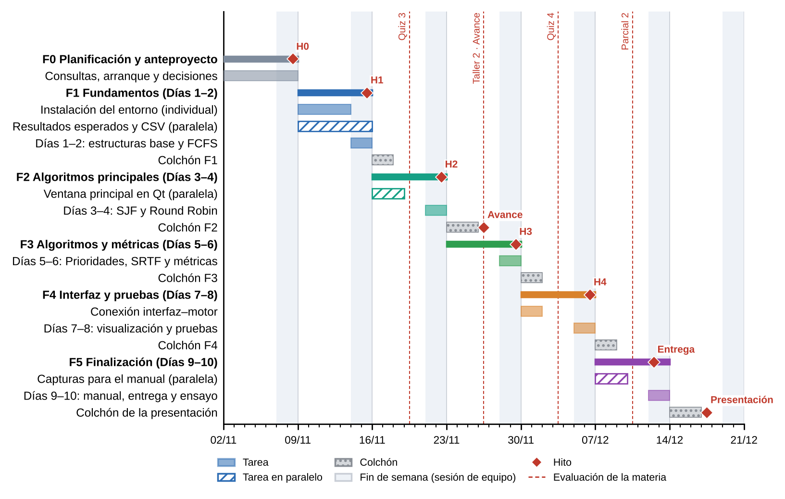
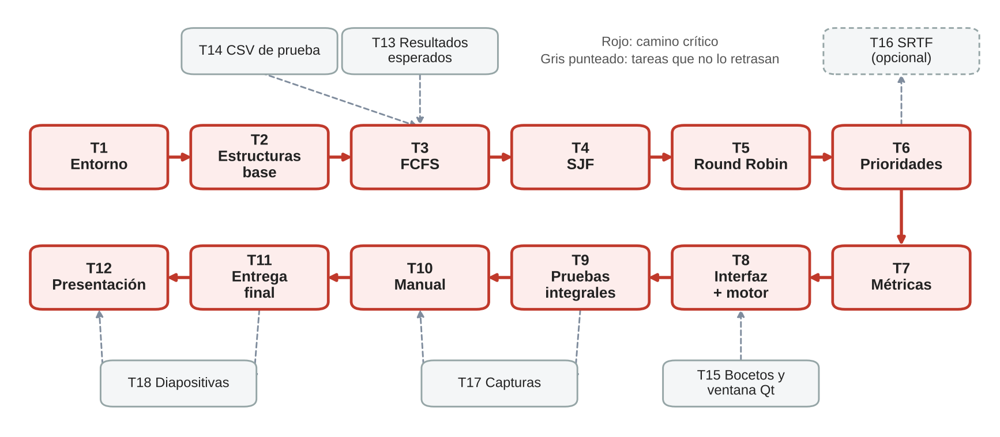

# Anteproyecto: archivos complementarios

El documento del anteproyecto se entregó en PDF por Canvas. Como la entrega admite un solo archivo, aquí están los archivos complementarios que pide el enunciado:

| Archivo | Contenido |
|---|---|
| [`Anteproyecto_Cronograma.gan`](Anteproyecto_Cronograma.gan) | Cronograma del proyecto para GanttProject |
| [`Anteproyecto_Matriz_y_Cronograma.xlsx`](Anteproyecto_Matriz_y_Cronograma.xlsx) | Matriz de roles, actividades por fase y cronograma tipo Gantt |

## Diagrama de Gantt

## Dependencias y camino crítico

